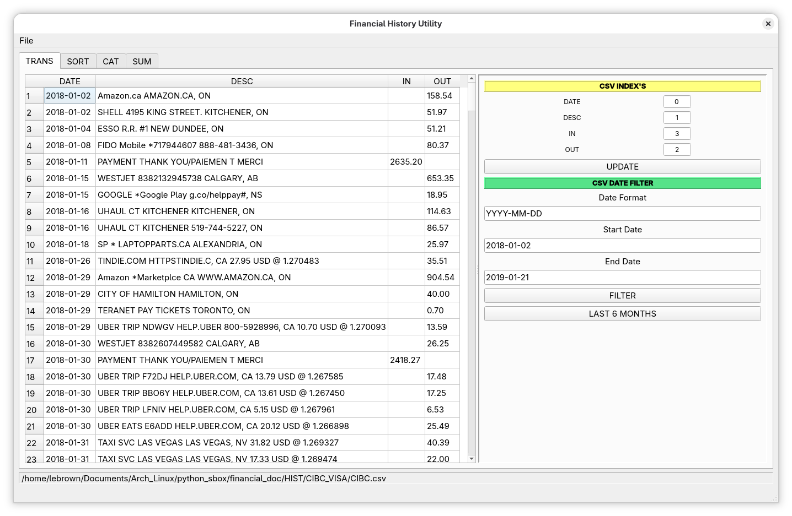
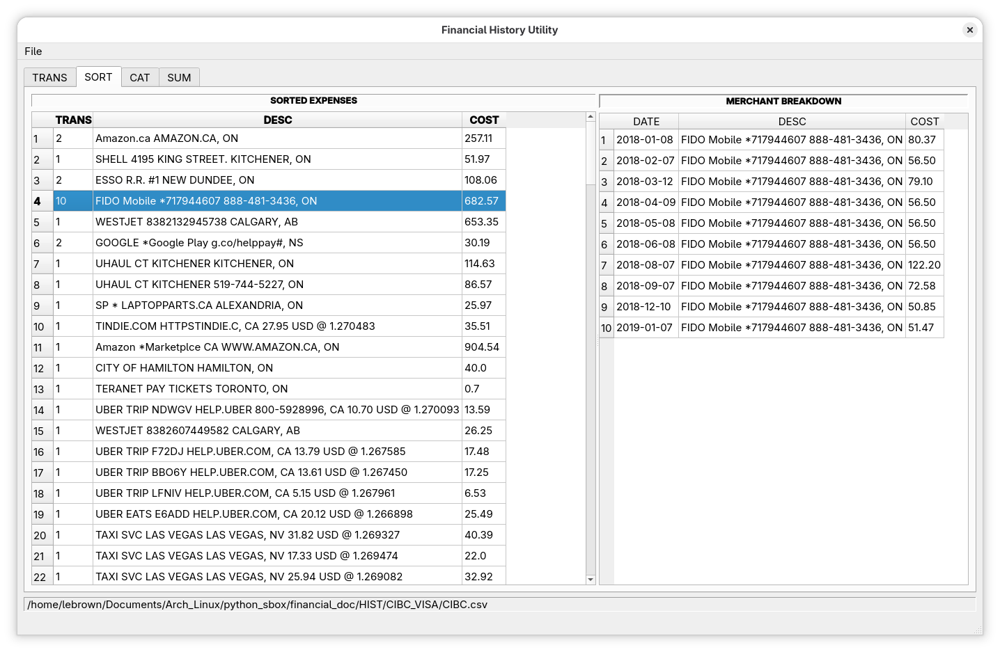
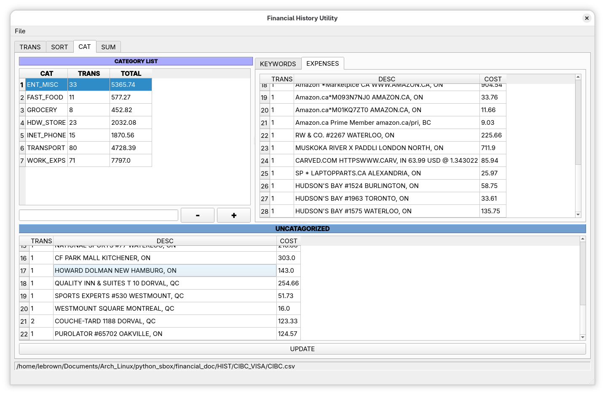

# financial_utility
***

A financial utility for sorting and categorizing financial transactions. It works for either debit or credit transactions first grouping the transactions by merchant then custom categories are created or loaded.

The categories use a comma separated text file with loosely correlated keywords. So if the keyword exists in the merchant ID the expense is included in the category.

## Application Interface

Interface has four tabs:
* TRANS
* SORT
* CAT
* SUM

**TRANS:**

This tab controls and displays the raw transactions that are included in the analysis the CSV INDEX'S are set according to the CSV's format and a date filter can be applied before sorting and categorizing.

*Note that the specified Date Format must be the same as the CSV*

**SORT:**

Tab shows the sorted expenses grouped by merchant and the total cost for that merchant. The merchant breakdown show the Highlighted rows transactions.

**CAT:**

 The category tab allows you to add categories or keywords to existing categories. If the category name is empty and you click the add button it will open a file dialog where you can select one or more category files.

**SUM:**

Tab simply generates monthly sums cash in subtract the cash out not all that useful for credit transactions but can show your monthly income for a debit account. 